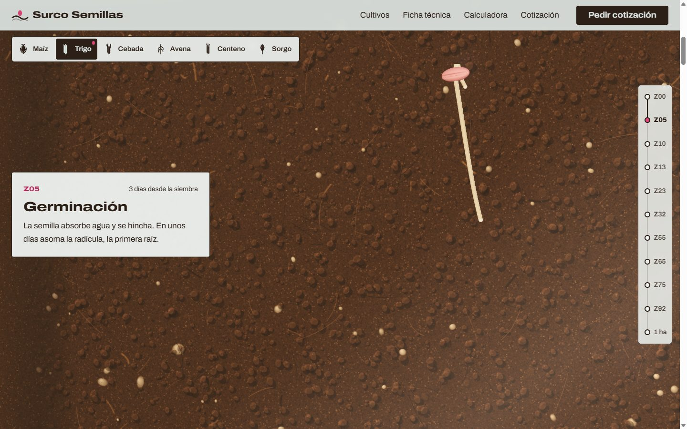
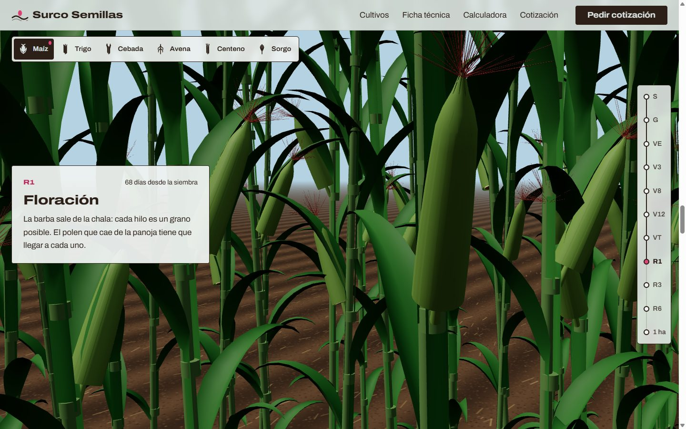
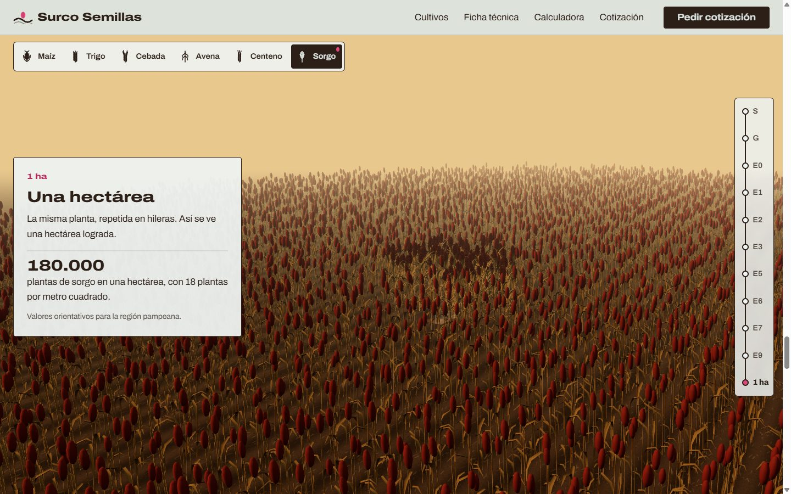
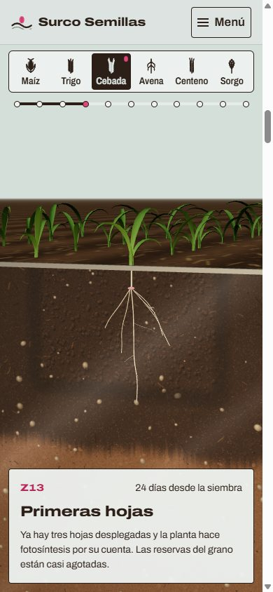
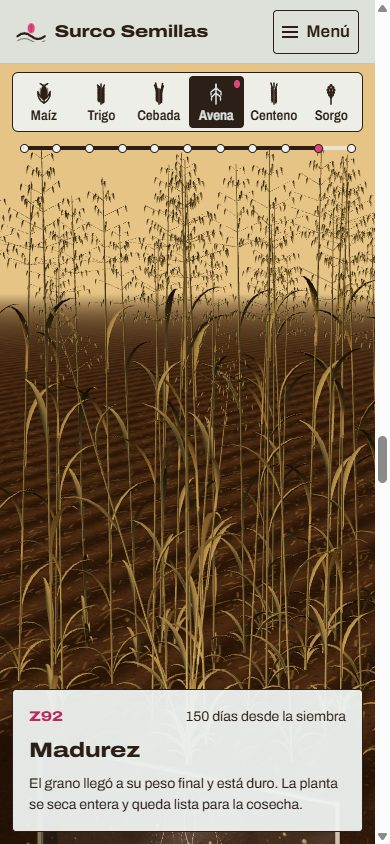
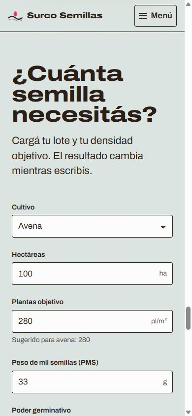
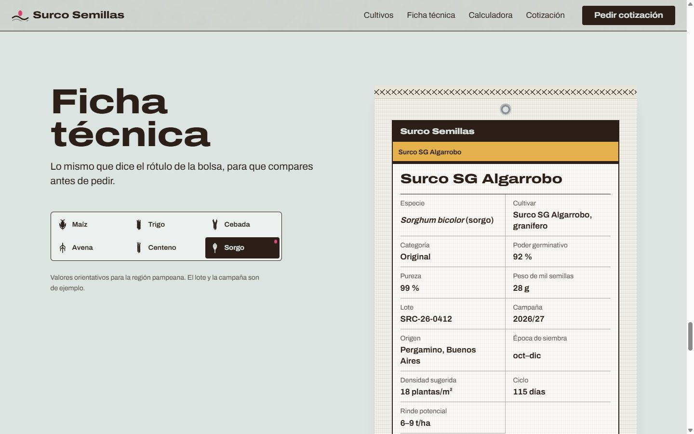

# Surco Semillas

Sitio de una semillera ficticia de Pergamino (Buenos Aires) que vende semilla de maíz, trigo, cebada, avena, centeno y sorgo. La pieza central es una escena 3D: con el scroll ves nacer y crecer cada cultivo, desde la semilla bajo tierra hasta una hectárea madura que se mueve con el viento.

Todo el 3D se genera por código: no hay modelos, texturas ni imágenes descargadas.

> Proyecto ficticio de portfolio. Diseño y desarrollo: Jose Muller.



## Qué tiene

- **Un rizotrón**: la caja de vidrio con tierra que usan los agrónomos para ver las raíces. La cámara arranca pegada a la semilla, sube con el tallo hasta la espiga (o el choclo) y al final se aleja hasta ver la hectárea entera.
- **Seis cultivos con forma propia**: espigas con aristas (trigo, cebada, centeno), panoja abierta (avena), panoja compacta (sorgo) y maíz con panoja, choclo, chala y barba. Hay macollos, polen en la floración y un secado gradual hacia la madurez.
- **Once etapas reales**: escala Zadoks para los cereales de invierno, V/R para maíz y Vanderlip para sorgo, con los días desde la siembra de cada cultivo.
- **Ficha técnica** con estética de rótulo de bolsa, **calculadora de semilla** (kg/ha, kg totales y bolsas) y **formulario de cotización** con validación accesible.

| Maíz en floración (R1) | Sorgo: una hectárea |
| --- | --- |
|  |  |

| Cebada, primeras hojas | Avena madura | Calculadora |
| --- | --- | --- |
|  |  |  |



## Stack

- React 19 + Vite, en JavaScript.
- `three` + `@react-three/fiber` para el 3D, sin `@react-three/drei`.
- CSS Modules y variables en `src/styles/global.css`, sin librerías de UI.
- Archivo variable (`@fontsource-variable/archivo`) autoalojada, con el eje de ancho.
- Sin backend: los formularios validan y confirman en el navegador.

## Cómo correrlo

Necesitás Node 22.12 o más nuevo y pnpm (la versión exacta está en `packageManager`; con `corepack enable` se instala sola).

```bash
pnpm install
pnpm dev        # servidor de desarrollo en http://localhost:5173
pnpm test       # tests de la fórmula de la calculadora
pnpm lint       # oxlint
pnpm build      # compila a dist/
pnpm preview    # sirve dist/ en http://localhost:4173
```

## Cómo publicarlo

`vite.config.js` usa `base: './'`, así que el mismo build funciona en la raíz de un dominio o en una subcarpeta.

Las redes sociales piden URLs absolutas para la imagen de vista previa (`og:image`). Al compilar, Vite completa `%SITE_URL%` en `index.html` con este orden:

1. la variable `SITE_URL`, si está definida;
2. en Vercel, la URL de producción del proyecto (`VERCEL_PROJECT_PRODUCTION_URL`);
3. si no hay ninguna, una ruta relativa, y se omite `og:url`.

### Vercel

1. Subí el repo a GitHub.
2. En Vercel, **Add New > Project** e importá el repo. Detecta Vite solo: el comando de build es `pnpm build` y la carpeta de salida es `dist`.
3. **Deploy**. Si después le asignás un dominio propio, definí `SITE_URL` (por ejemplo `https://surcosemillas.com.ar`) en **Settings > Environment Variables** y volvé a publicar.

Con la CLI: `pnpm dlx vercel` para una vista previa y `pnpm dlx vercel --prod` para producción.

### GitHub Pages

El workflow `.github/workflows/deploy.yml` corre lint, tests y build en cada push a `main`, y publica `dist/` en Pages con la URL correcta en `SITE_URL`.

1. Subí el repo a GitHub.
2. En el repo, **Settings > Pages > Build and deployment > Source**, elegí **GitHub Actions**.
3. Hacé push a `main` (o corré el workflow a mano desde **Actions**). El sitio queda en `https://<usuario>.github.io/<repo>/`.

## Estructura

```
src/
  data/          cultivos, variedades, etapas, textos y fotogramas de crecimiento y cámara
  hooks/         progreso del scroll, movimiento reducido, visibilidad en pantalla
  utils/         generador aleatorio con semilla, calculadora (con tests), detección de WebGL
  three/
    GrowthScene.jsx   canvas, luces, cielo, niebla
    CameraRig.jsx     cámara por etapa
    Rhizotron.jsx     caja de vidrio y suelo
    soil*.js          textura del suelo, dibujada en un Web Worker
    Plant.jsx         arma la planta según el cultivo y la etapa
    parts/            semilla, raíces, tallo y hojas
    heads/            espiga, panoja abierta, panoja compacta y maíz
    Pollen.jsx, Neighbors.jsx, Field.jsx, wind.js
  components/    header, historia con paneles y riel, selector, ficha, calculadora,
                 cotización, footer y la versión estática sin WebGL
```

## Decisiones

- **El scroll no pasa por el estado de React.** El progreso vive en un `ref` y la escena lo persigue con `MathUtils.damp` dentro de `useFrame`. React solo se entera cuando cambia la etapa, para actualizar los paneles.
- **Geometría procedural con semilla fija** (mulberry32): cada cultivo sale siempre igual, sin assets que descargar.
- **El suelo se dibuja en un Web Worker** con `OffscreenCanvas`, con respaldo en el hilo principal. Mientras tanto queda la semilla en SVG.
- **Carga diferida**: three.js va en un chunk aparte (`React.lazy`). El render se pausa cuando la historia sale de pantalla.
- **Mobile**: menos segmentos, sin sombras y menos plantas en la hectárea.

## Accesibilidad

- El canvas lleva `aria-hidden`: toda la información está en los paneles de texto.
- Se recorre entero con teclado. El selector de cultivo es un grupo de radio y se maneja con las flechas.
- Con `prefers-reduced-motion` no hay viento ni polen, y la cámara salta de etapa en etapa.
- Sin WebGL se ve una ilustración SVG por etapa, con los mismos paneles.
- Lighthouse: 100 en accesibilidad, buenas prácticas y SEO.

Los valores de los cultivos son orientativos para la región pampeana. Las variedades, el lote y la empresa son inventados.
